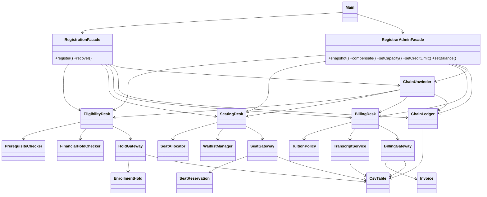

# University Registration: Facade over a three-stage chain

Java 17, Maven, no runtime dependencies. State lives in CSV files under `data/`.

## Run
- Tests and coverage: `mvn verify` (JaCoCo report in `target/site/jacoco/index.html`, build fails below 80% line coverage; `Main` is excluded from the check)
- Demo application: `mvn -q compile exec:java`
- Reset persisted state before a fresh run: `mvn -q compile exec:java -Dexec.args="data --reset"` or menu item 8 (or delete `data/*.csv`)

## Subsystems and chain
| | Subsystem | Logic classes | State / gateway | Status |
|---|---|---|---|---|
| A | `EligibilityDesk` | `PrerequisiteChecker`, `FinancialHoldChecker` | `EnrollmentHold`, `HoldGateway` | HELD, CONFIRMED, RELEASED |
| B | `SeatingDesk` | `SeatAllocator`, `WaitlistManager` | `SeatReservation`, `SeatGateway` | RESERVED, CONFIRMED, RELEASED |
| C | `BillingDesk` | `TuitionPolicy` | `Invoice`, `BillingGateway`, `TranscriptService` | ISSUED, PAID, VOIDED |

Chain progress is stored in `chains.csv` (`ChainLedger`): PENDING_A, PENDING_B, PENDING_C, COMPLETED, COMPENSATED, REJECTED.
The facade passes the chain id to every subsystem as an opaque reference. Each subsystem stores it, so after a restart the facade finds what is really on disk (`holdFor`, `seatFor`, `invoiceFor`) and decides what to undo, not an in-memory flag.

| Scenario | Demo | Result |
|---|---|---|
| A fails (financial hold, missing prerequisite) | S3 or S4 via menu 1 | nothing committed, chain REJECTED |
| B fails after A | menu 3 (S1 -> CS301, course full) | hold released, chain COMPENSATED |
| C fails after A and B | menu 4 (S2 -> CS201, tuition above credit limit) | seat released, then hold released |
| success | menu 5 (S1 -> MATH201) | everything confirmed, invoice PAID, transcript ENROLLED |

Menu 7 changes capacity, credit limit or balance, so any failure can be produced on demand. After a crash, `RegistrationFacade.recover()` runs on startup: an unfinished chain with hold, seat and invoice is rolled forward, anything else is unwound in the order C, B, A.

## Principle of Least Knowledge
Before (client knows three subsystems and their compensation order):
```java
String hold=eligibility.placeHold(ref,student,course);
String seat;
try{seat=seating.reserve(ref,student,course);}catch(RuntimeException e){eligibility.release(hold);throw e;}
String invoice;
try{invoice=billing.bill(ref,student,course);}catch(RuntimeException e){seating.release(seat);eligibility.release(hold);throw e;}
seating.confirm(seat);eligibility.confirm(hold);billing.settle(invoice);
```
After (client knows one object):
```java
ChainLedger.Chain chain=facade.register(student,course);
```
Administrative work goes through the second facade: `admin.snapshot()`, `admin.compensate(chainId)`, `admin.setCapacity(...)`.

## Facade vs Adapter
An Adapter exists to make one existing interface fit the interface a client already expects; it translates calls and changes nothing about what the client has to know. Here nobody expects a particular interface: `EligibilityDesk`, `SeatingDesk` and `BillingDesk` are independent and each is fine as it is. The problem is that one logical operation, registering for a course, spans all three, must run in a fixed order, and must be undone partially and in reverse order when a later step fails. That knowledge (sequencing, persisted chain state, the right compensation depth) has to live somewhere, and the intent of Facade is exactly to put it behind one simple entry point so clients stay ignorant of the subsystems. An adapter would have wrapped a single desk; it could not own a three-step workflow.

## UML

Export to SVG at https://mermaid.live for the submission.

## Tests
`RegistrationTest` (JUnit 5, fresh `@TempDir` per test). Domain DSL: `campus.registers("S2","CS201").failedAt("C").seatIs(RELEASED).holdIs(RELEASED).undoneInOrder("seat","hold")`. Covers: each subsystem standalone, both compensation depths, extra failures (financial hold, prerequisite, unknown student, invalid input, duplicate), restart mid-chain (after A, after B, after C, ledger not updated, interrupted compensation), manual compensation and the scripted console session.
